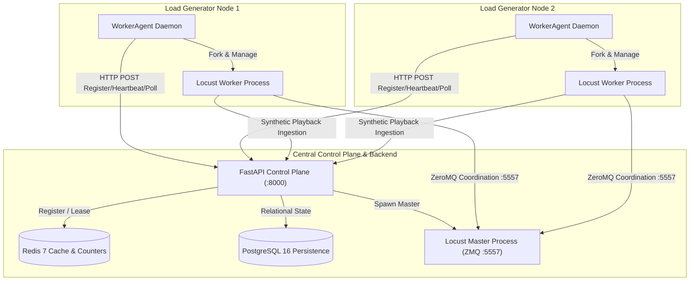

# ViewStorm Distributed Architecture

## 1. System Topology Overview

ViewStorm's distributed execution architecture decouples simulation control, coordination, and load generation into specialized subsystems:

---

## 2. Distributed Components

### Central Control Plane (FastAPI)
- Handles user simulation requests (`/api/v1/runs`).
- Dynamically selects active load generator nodes from `LoadGeneratorNode` based on Redis leases (`viewstorm:workers:{id}:heartbeat`).
- Performs deterministic, capacity-aware load balancing across workers ($\sum u_i = U$).
- Spawns and manages the central Locust master subprocess with `--master` and `--expect-workers`.
- High-throughput event ingestion endpoint (`/api/v1/events/playback`) backed by atomic Redis Lua scripts.

### ZeroMQ Master-Worker Communication
- Central master process binds to port `5557` (and internal port `5558`).
- Master does not generate traffic itself; it acts solely as the orchestrator and metrics aggregator.
- Workers connect directly to the master via ZeroMQ.
- Master coordinates ramp-up, greenlet scheduling, and aggregates request statistics into real-time CSV artifacts (`artifacts/runs/{run_id}/stats`).

### Outbound WorkerAgent
- Standalone daemon running on each remote or containerized load generator node.
- Follows an **outbound-only** networking model: the agent dials out to the FastAPI control plane. No inbound listening ports are opened on worker hosts.
- Emits periodic resource heartbeats (CPU, RAM, active workers) and polls for workload assignments.
- Spawns and supervises local `locust --worker` subprocesses.

---

## 3. Data Model & State Transitions

### `LoadGeneratorNode`
Tracks authenticated physical/virtual machines capable of running simulations:
- `id`: Internal UUID identifier (e.g. `node-a1b2c3d4e5f6`).
- `worker_identifier`: Hardware UUID or hostname-derived persistent identifier.
- `capacity`: Maximum concurrency capacity (default: 100-10,000 users).
- `status`: `online`, `busy`, `stale`, `offline`, `incompatible`.
- `locust_version`: Pinned version validation (`2.47.0`).
- `last_heartbeat`: UTC timestamp of latest agent check-in.

### `SimulationWorker`
Tracks individual assignment records per simulation:
- `run_id`: Associated simulation run.
- `worker_node_id`: Foreign key reference to `LoadGeneratorNode`.
- `assigned_users`: Virtual viewers allocated to this node ($\sum = \text{run.virtual\_users}$).
- `active_users`: Live active user sessions reported by worker.
- `status`: `assigned`, `running`, `completed`, `failed`.

---

## 4. Workload Distribution Algorithm

Let $U$ be total requested virtual users and $W = [w_1, w_2, \dots, w_k]$ be the active online workers with capacities $c_i$:

1. **Total Cluster Capacity**: $C = \sum_{i=1}^k c_i$.
2. **Proportional Allocation**:
   $$u_i = \max\left(1, \left\lfloor U \times \frac{c_i}{C} \right\rfloor\right)$$
3. **Remainder Resolution**:
   Calculate remainder $R = U - \sum u_i$.
   - If $R > 0$: Distribute leftover users 1-by-1 to workers sorted by fractional remainder descending.
   - If $R < 0$: Decrement 1 user from workers with $u_i > 1$ sorted by allocation descending.
4. **Conservation Guarantee**:
   $$\sum_{i=1}^k u_i \equiv U$$
   and each active node receives a proportional spawn rate $r_i$ such that $\sum r_i = \text{total spawn rate}$.
