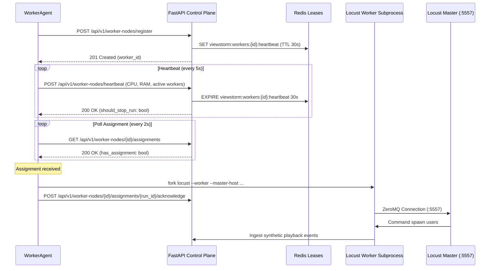

# ViewStorm Worker Agent Specification

## 1. Overview

`viewstorm-agent` is an autonomous background daemon engineered to run on distributed load generator instances. It bridges the central FastAPI control plane and local Locust worker subprocesses without exposing any open listening ports on the host.

---

## 2. Agent Execution Flow



---

## 3. CLI Options & Configuration

The agent can be started using the CLI entrypoint:

```bash
python -m viewstorm_agent.main \
  --server-url "http://controlplane.internal:8000" \
  --token "viewstorm-secret-token" \
  --name "loadgen-us-east-01" \
  --capacity 500 \
  --locustfile "simulator/locustfile.py" \
  --log-level "INFO"
```

### Environment Variables
All options can also be provided through environment variables:
- `VIEWSTORM_SERVER_URL`: Base URL of the FastAPI backend.
- `VIEWSTORM_WORKER_AUTH_TOKEN`: Shared secret or per-node token.
- `VIEWSTORM_WORKER_NAME`: Node label.
- `VIEWSTORM_WORKER_CAPACITY`: Maximum users this instance can support.
- `VIEWSTORM_HEARTBEAT_INTERVAL`: Heartbeat interval (default: `5.0` seconds).
- `VIEWSTORM_POLL_INTERVAL`: Workload polling frequency (default: `2.0` seconds).

---

## 4. Failure Recovery & Orphaned Process Handling

- **Control Plane Disconnect**: If the backend is unreachable during registration or heartbeat, the agent exponentially backs off and retries while keeping existing workers alive until the run's duration completes.
- **Run Abortion**: If a user cancels a simulation via the UI or API (`/api/v1/runs/{id}/stop`), the subsequent heartbeat response returns `should_stop_run=True`. The agent immediately sends `SIGTERM` to the local worker process and cleans up.
- **Crash Recovery**: If the agent process crashes, the Redis lease expires within 30 seconds. The backend marks the node as `stale` and reallocates pending assignments if necessary.
